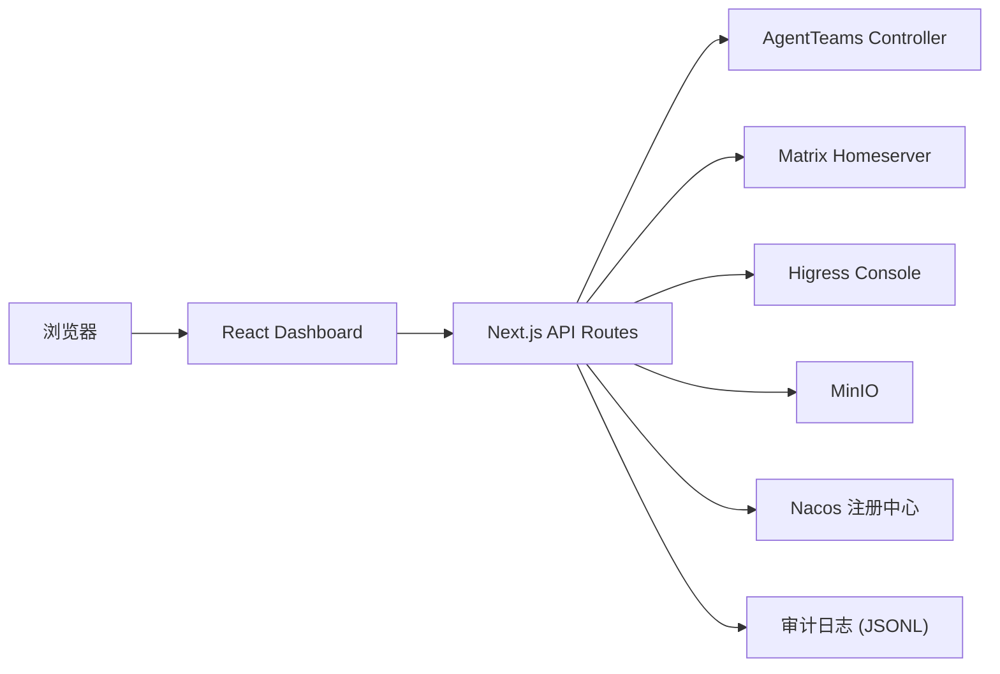

# AgentTeams Dashboard 架构

## 概述

AgentTeams Dashboard 是用于管理 AgentTeams 集群资源的 Next.js Web 控制台。它管理 Worker、Team、Human、Manager、技能中心、基础设施状态与 Matrix 聊天，并通过服务端路由代理访问外部系统。

浏览器调用 Dashboard 自身的 API；Next.js 路由再访问 AgentTeams Controller、Matrix Homeserver、Higress Console、Nacos 注册中心或 MinIO 对象存储。该边界将认证令牌、会话 Cookie、超时和目标地址校验保留在服务端。

技能中心支持三种来源的技能管理：用户自定义上传（`custom`）、从 Nacos 注册中心同步（`nacos`）和内置全局技能（`builtin`）。Nacos 来源的技能在 Worker 创建时自动从注册中心拉取内容并安装。

## 技术栈

- Next.js 16、React 19、TypeScript 5
- Tailwind CSS 4 和 shadcn/ui
- TanStack Query 与 Zustand
- Vitest 和 Testing Library
- AgentTeams Controller、Matrix、Higress Console、MinIO 为可选外部依赖

## 结构

```text
src/
  app/                 Next.js 页面、布局和 API 路由
    api/
      agentteams/
        skills/        技能 CRUD、上传下载与分发
          nacos/        Nacos 技能下载、配置管理与同步
        debug-log/     一键调试日志收集（容器诊断、会话、Matrix 消息打包 ZIP）
  components/          Dashboard、认证、设置与 UI 组件
    dashboard/
      sections/
        skills/        技能中心页面组件
  hooks/               TanStack Query 数据读取与 mutation 封装
  lib/                 API 客户端、代理认证、状态与纯工具
    skill-center-*.ts  技能中心存储、配置与类型定义
install/               独立安装脚本与 AgentTeams 集成补丁
```

## 子系统

### Dashboard UI

位置：`src/components/dashboard/`

负责导航、资源管理界面、基础设施状态和模型管理。各 section 通过 hooks 获取数据。

Dashboard 导航分两层：侧栏一级入口由 `workspace-navigation.tsx` 的 `workspaceMenus` 定义（助手 / 我的团队 / 工作台 / 资产中心 / 成员与团队 / 观测与治理），各入口的二级项来自 `nav-items.ts`（含 `area`、`group`、`minLevel`、`hiddenByFlag`）。深链接唯一映射层是 `src/lib/nav-hash.ts`：section id 保持扁平，`hashForSection` 输出分层哈希（`#workbench/space`、`#console/resources/workers`），旧扁平哈希首次解析时经 `history.replaceState` 归一化，带 roomId/params 的分层哈希不归一化。`use-active-section.ts` 把当前节持久化到 localStorage；总览、问天、插件、主题、更新等管理面入口收敛到左下角设置弹窗（`settings/management-tab.tsx`）。

### AgentTeams 代理

位置：`src/app/api/agentteams/`、`src/lib/agentteams-api.ts`

负责将 Dashboard 请求转发到 Controller，处理授权令牌、超时和错误响应。

### Matrix 代理

位置：`src/app/api/matrix/`、`src/lib/matrix-api.ts`

负责 Matrix 登录、房间、消息与同步请求。代理层实施 homeserver 允许列表。

### Higress 集成

位置：`src/app/api/higress/`、`src/lib/higress-api.ts`

负责 Higress Console 的 Provider 与 AI Route 管理。Provider 响应在返回浏览器前移除 Token 值。

### A2UI 聊天渲染

位置：`src/components/dashboard/sections/chat/`、`src/hooks/use-matrix.ts`、`src/lib/a2ui/`

`formatMatrixEvents` 按时间排序 Matrix 事件，将 `m.replace` 修订合并回根事件，保留根事件 ID 和时间戳以保证流式响应在时间线中的位置稳定。`m.thread` 回复只计入根事件的回复数；线程面板通过 relations API 按需获取完整回复，主时间线保持根消息视图。

`MessageBubble` 使用 `parseA2uiContent` 将正文和 `formatted_body` 解析为 A2UI 协议消息、AgentScope runtime `Message` repr、`agentteams.workflow`、Tool Guard 确认、legacy thinking/卡片块与纯文本。repr 解析器按消息边界保留正文、推理和函数调用信息，并映射为 Markdown、可折叠思考和工具调用卡片。`agentteams.workflow` 映射到专用工作流卡片。`org.agentteams.run` 是供 runtime adapter 使用的可选兼容载荷，并非 Dashboard 依赖的唯一消息协议。

聊天时间线由 `ScrollPanel` 的 `react-virtuoso` 容器承载，可测量动态高度消息、在顶部加载更早页并通过稳定消息键保持可视锚点。列表仅在用户停留于底部时跟随新增消息；跳转至指定消息会居中滚动、短暂高亮，并通过屏幕阅读器状态文本反馈定位结果。文本气泡使用 `min(92%, 72ch)` 宽度上限，结构化卡片使用 `min(100%, 56rem)`，在窄面板中保持可用宽度。

### 技能中心

位置：`src/app/api/agentteams/skills/`、`src/lib/skill-center-*.ts`、`src/components/dashboard/sections/skills/`

负责技能的存储、上传、下载与分发。技能以 ZIP 包形式存储在 MinIO 的 `skills` bucket 中，元数据以 JSON 文件记录于 `skills/` 前缀下。支持三种来源：

- `custom`：用户通过 Dashboard 上传的自定义技能，可覆盖更新。
- `nacos`：从 Nacos 注册中心同步的技能元数据，内容在首次下载时自动从 Nacos 拉取并缓存到 MinIO。Nacos 技能不可覆盖（返回 403），需通过 Nacos 侧更新后重新同步。
- `builtin`：全局内置技能，从主 bucket 的 `agents/global/skills/` 前缀读取，仅可安装到 Worker。

技能分发流程：Worker 创建/编辑时指定技能名称列表，Dashboard 按名称逐一下载技能 ZIP 并通过 `POST /workers/{name}/skills` 推送到 Worker。通用技能下载 403 时自动降级到 Nacos 专用下载端点。

### Nacos 集成

位置：`src/app/api/agentteams/skills/nacos/`、`src/lib/skill-center-config.ts`

负责与 Nacos 注册中心的技能元数据同步。配置通过 `PUT /api/agentteams/skills/nacos/config` 管理，以 `nacos://host:port/namespace` 格式的 URL 标识注册中心。

支持两种同步模式：
- `services`：通过 Nacos 服务发现 API (`/v1/ns/catalog/services`) 列出服务，以服务元数据中的 `homePageUrl` 字段作为技能包下载地址。
- `skills`：通过 Nacos 3.2+ 技能 API (`/v3/console/ai/skills/detail`) 获取 base64 编码的 ZIP 内容。

同步流程 (`POST /skills/nacos/sync`)：从 Nacos 拉取技能列表，为每个技能写入元数据 JSON（不含实际文件内容），后续 Worker 安装时通过下载端点按需拉取实际文件并缓存在 MinIO 中。

### 部署集成

位置：`install/`

负责 Dashboard 容器启动和与 AgentTeams 安装器的补丁集成。`install/AGENTTEAMS_PATCH.md` 记录外部 AgentTeams 源码绑定。



## 服务端治理（v1.2.4 起）

`src/middleware.ts` 在 Higress session 通过验证后，注入 `x-agentteams-user` / `x-agentteams-user-level` 两个请求头；`src/app/api/agentteams/proxy-helper.ts` 透传给 Controller 便于审计关联。`src/lib/server-auth.ts` 的 `enforceServerSideRbac` 调用既有 `src/lib/rbac-engine.ts`（3 级权限 + 显式规则 deny 优先），对 workers / teams / managers / humans 的写操作路由做服务端细粒度校验；403 时自动写一条 warning 审计。

审计事件落 `src/lib/audit-log.ts` 维护的 append-only JSONL（10 MB rotate，保留 30 份归档，路径由 `AGENTTEAMS_AUDIT_LOG_PATH` 覆盖，默认 `${cwd}/logs/audit.log.jsonl`）。客户端 `auditMutation`（`src/lib/audit-store.ts`）每次写入同时镜像到服务端 `/api/agentteams/audit` POST，失败仅 warn 不阻塞 mutation。审计列表查询走 `GET /api/agentteams/audit`，按身份等级分流：L2 仅能看自己的事件（服务端强制 `actor = identity.name`），L3 可看全量；L1/无身份返回 403，响应体带 `observedLevel` / `requiredLevel`，前端据此区分「身份头缺失」与「等级不足」。403 响应同时写一条 warning 审计。

## 运行时消息协议（`org.agentteams.run`）

Dashboard 解析 Matrix 消息时优先识别 `content['org.agentteams.run']` 结构化载荷（`src/lib/a2ui/protocol.ts` 定义 discriminated union：text / thinking / tool_call / confirmation / error），按 `version` 字段分流：

- `version: "1"` 走 `parseAgentRunBlocks` 的规范化路径，补齐 `tool_call_id` / `status` / `started_at` / `finished_at` 等字段，confirmation 块强制 `confirmation_id`
- `version: "0"` / 缺省走原有透传语义
- 未知版本一律降级到 13 级文本启发式规则而不丢消息

上游 runtime 接入此协议后即可替代现有文本启发式路径。`recordToolCalls` 接受可选 `structuredKeys`，v1 块含 `tool_call_id` 时按 id 为权威去重键，跨设备/跨修订一致。

## 任务看板、产物与循环

位置：`src/app/api/agentteams/projects/`、`src/lib/agentteams-projects-api.ts`、`src/components/dashboard/sections/tasks-section.tsx`、`artifacts-section.tsx`、`loops-section.tsx`

项目（Project）由 Manager 通过 `TeamHarness.projectflow` 落到 `shared/projects/{id}/meta.json`，Dashboard 只读 + 干预：列表/卡片/拓扑三视图、attention 待决策聚合、pause/resume/replan、事件流游标翻页、历史快照与 spawns 会话消息。`loop` 类型项目带 `pause_sources`（`user` / `project`），恢复只清理一个来源。

产物（Artifacts）复用项目端点，把「项目 → 任务 → 产物文件树」呈现为左右分栏，支持类型筛选、Markdown/图片/文本预览与下载；上游 404（未部署）或 5xx 分别降级为不同横幅。编码执行记录（Coding runs）是独立只读数据面，透传上游 `coding-runs` 列表与原始日志，`?format=json` 返回结构化信封。

循环（Loops）的定义/发布/回滚由 Dashboard 承载：`loop-definition.ts` 做校验，画布组件按需分包（`@xyflow/react` 不进主 bundle），草稿存 localStorage，执行仍在上游 runtime。

## HITL 与干预

位置：`src/lib/hitl-inbox.ts`、`src/components/dashboard/sections/hitl-inbox-card.tsx`

HITL 收件箱从 Matrix 时间线提取待审批的 Tool Guard / v1 `org.agentteams.run` 确认请求，按时间排序摄入并处理 `m.replace` 修订；全局 sync（`use-global-matrix-sync.ts`）在历史加载与实时同步两条路径上都会摄入。store 暴露 `takePendingChatRoomId` 等原子消费方法，供组件在渲染期消费而不在 effect 里 setState。

上游 runtime 只回纯文本时，`intervention-heuristic.ts` 把「问句/引导行 + 连续编号选项」升格为 InterventionCard；代码块、无疑问语义、流式与自己的消息不参与升格，提交走 `composeAnswerText` 回房间。

## 知识库与文件

位置：`src/app/api/agentteams/workers/[name]/workspace-files/`、`humans/[name]/files/`、`teams/[name]/files/`、`src/components/dashboard/sections/knowledge-section.tsx`、`files-section.tsx`

知识库读取 QwenPaw 工作区布局（MEMORY.md / memory/** / digest/**），按团队聚合各 Worker 的 Markdown 建图；图谱默认 3D（`knowledge-graph3d.tsx`，按需分包，WebGL 失败降级 2D），预览与图谱双卡并存。

文件区覆盖 Human 私有空间（列表/树/网格、上传、编辑、回收站、配额）与 Team 共享空间（上传/下载），聊天侧的文件引用（`com.agentteams.file_refs`）与之共用选择器。

## Worker 链路追踪

位置：`src/app/api/agentteams/observability/`、`traces/`、`src/lib/observability-controller.ts`、`agentloop-server.ts`、`tracing-server.ts`

可观测配置由 Controller 持有（`agentteams-observability` Secret 的 `data["config.json"]`），Dashboard 用调用方原有凭据代理读写，剥除客户端 `controllerUrl`，不再读取本地 `observability.json` 或 `LANGFUSE_*` 环境变量。查询后端双轨：`langfuse`（v3 写入、v1 查询）与 `agentloop`（阿里云 SLS 原始 Span，`@alicloud/credentials` 服务端凭证链，`AGENTLOOP_SLS_ENDPOINT` 可覆盖接入点）。采集开关按 Worker 下发，Langfuse 项目查询密钥只留在服务端。字段契约见 `docs/INTERFACES.md`。

## 语音输入

位置：`scripts/prepare-speech-assets.mjs`、`src/lib/speech-config.ts`、`src/app/api/agentteams/speech/`

默认本地识别：构建期把固定版本 Whisper tiny 模型与 WASM 备到 `public/speech/ff41770/`，浏览器在 Web Worker 内识别，音频不上传。付费百炼识别由服务端代理，配置保存在 `DASHBOARD_CONFIG_FILE` 同目录的 `speech.json`（0600），页面保存优先于环境变量，密钥不回显。

## 插件系统

位置：`src/lib/plugins/`、`src/components/plugins/`、`tools/create-dashboard-plugin/`

运行时通过动态 `import()` 加载 `plugin.json` 声明的 ES 模块，提供侧栏菜单、独立路由、仪表盘组件、详情面板区块、工具栏按钮五类扩展点；每插件错误隔离、独立状态、事件总线，开发态支持热更新。插件贡献的入口按等级门控（`minLevel`）隐藏，避免出现死链接。

## 热更新与版本

位置：`src/app/api/dashboard-build/`、`src/app/api/self-update/`、`scripts/build-hotfix-bundle.sh`

`/api/dashboard-build` 只读返回 buildId + version + builtAt（免认证、`no-store`），页面「设置 → 更新」比较内嵌版本、服务器版本与上游 release tag；一致版本不同构建号视为「已是最新」。热更新是应用内补丁通道（L1 可见）：下载 release 资产 → sha256 校验 → 热替换应用目录（旧版留 `app.prev`）→ 进程退出由容器监管方拉起，多副本 Pod 以镜像滚动更新为准。发版与三方版本一致性口径见 `docs/RELEASE.md`。

## Higress 外部适配

外部模式使用 Gateway 数据平面地址供 Manager 与 Worker 发起模型请求，使用可选 Console 地址供 Dashboard 管理 Provider 与 AI Route。两个地址是不同配置项；当前适配规格位于 `.monkeycode/specs/higress-ai-gateway/`。
