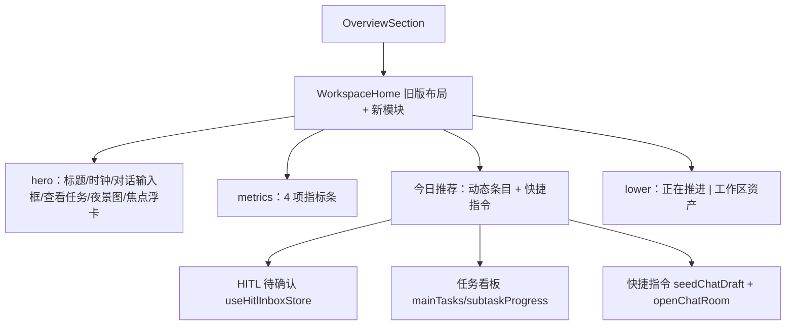

# 首页回滚旧版 + 对话输入框 + 今日推荐 — 技术设计

Feature Name: home-classic-revert-chat-recommendations
Updated: 2026-11-23

## Description

将首页从 WORKSPACE 改版状态回滚到改版提交前（`00f0582`）的旧版布局，并在旧版基础上新增两个模块：hero 内的**对话命令输入框**（替代「与AT助手对话」按钮）与指标条下方的**今日推荐**区块（动态推荐 + 快捷指令混合）。

## Architecture



## 回滚范围

| 文件 | 处理 |
| --- | --- |
| `src/components/dashboard/sections/workspace-home.tsx` | `git checkout 00f0582 -- ` 还原后叠加新模块 |
| `src/components/dashboard/sections/workspace-home.module.css` | 同上还原（含 hero 夜景图与 container query 字号） |
| `src/components/dashboard/sections/overview-section.test.tsx` | 还原旧断言（`container.childNodes` 长度为 1） |
| `src/components/dashboard/sections/chat/hooks/usePersistedDraft.ts` | **不回滚**：新对话输入框依赖 `seedChatDraft` |
| `public/fonts/alimama-dfk.woff2` | 改版引入的孤儿资产，无引用后保留待另行清理（不删文件） |
| `src/components/dashboard/sections/workspace-home.test.tsx` | 旧版不存在该文件；为新版重写覆盖旧布局 + 新模块 |

回滚后 HITL 收件箱卡（`hitl-inbox-card.tsx`）与插件挂槽（`plugin-widgets.tsx`）回到改版前未挂载状态，组件本身保留在仓库中。

## Components and Interfaces

### WorkspaceHome（沿用旧签名）

```ts
{ teams?: TeamResponse[]; managers?: ManagerResponse[]; workerCount?: number;
  tasks: BoardTask[]; loading: boolean; degraded: boolean }
```

### 新增：对话命令输入框（hero 内，替代「与AT助手对话」按钮）

- 受控 input：placeholder「今天想完成什么？交给 Agent 开始...」；`Enter` 或点击圆形发送按钮提交。
- 两个可切换 chip：「+ 添加上下文」「自动分配 Agent」（本地 state，纯视觉态）。
- 发送：`seedChatDraft(roomID, text)` + `openChatRoom(roomID)`；无房间时仅 `navigate('chat')`，不写草稿。
- 空文本时发送按钮禁用；`level >= 3` 门控保留（低等级用户不展示输入框）。
- 「查看任务」按钮原位保留。

### 新增：今日推荐（metrics 与 lower 之间，通栏）

```ts
interface Recommendation {
  key: string;
  title: string;      // 如「确认 shell_exec」「推进 协作闭环稳定性验证」
  meta: string;       // 房间名 / 团队名 / 状态说明
  action: () => void; // openTasks(task) 或 openChatRoom(roomId)
}
```

派生规则（上限 3 条，HITL 优先）：

1. `useHitlInboxStore` 未决议定（confirmations 中无 resolution）：每条生成「确认 {toolName}」，点击 `openChatRoom(roomId)`。
2. 活跃任务（`assigned` / `in_progress` / `revision` / `submitted`）第一条：「推进 {title}」，点击 `openTasks(task)`；`submitted` 状态标注「待验收」。
3. 底部固定快捷指令 chips：「今天先做什么」「生成本周周报」，点击走对话输入框同一发送链路（seed + 深链）。

## Data Models

- 推荐条目由 `tasks` + `useHitlInboxStore().confirmations` 现场派生，不新增 store、不新增 API 契约。
- 快捷指令为组件内静态字符串数组。

## Correctness Properties

1. 旧版行为不回退：`level >= 3` 门控、`openTasks` hash 深链、`taskStatus` 状态色、4 项指标计算、时钟分钟级对齐均与 `00f0582` 一致。
2. 输入框空文本时发送禁用；非空发送必须同时完成「写草稿 + 切 section + 记 pendingChatRoomId」。
3. 无 AT 助手房间时只切 section，不产生草稿写入。
4. 推荐条目上限 3 条且 key 唯一；HITL 条目优先于任务条目。
5. 全页面仅使用主题令牌颜色与全局字体栈，不引用 `AlimamaDFK`。

## Error Handling

- 任务看板 `loading`：今日推荐展示加载态（「正在加载推荐…」），不展示空态文案。
- 任务看板 `degraded`：今日推荐展示降级文案，快捷指令仍可用。
- 无动态推荐：展示空态文案 + 快捷指令 chips 保持可点击。

## Test Strategy

- 旧布局回归：hero 标题/副标题/时钟/查看任务、指标条 4 项、正在推进前 3 条、工作区资产 3 行、`level < 3` 隐藏对话入口。
- 对话输入框：发送写草稿并深链（`pendingChatRoomId` + `activeSection`）、空文本禁用、chip 切换选中态、无房间降级只切 section。
- 今日推荐：HITL 优先且上限 3、点击跳转对应房间/看板、空态、加载态、降级态。
- `overview-section.test.tsx` 恢复旧断言。
- a11y-axe 无 critical/serious 违规。

## References

[^1]: `git show 00f0582:src/components/dashboard/sections/workspace-home.tsx` — 旧版首页实现（回滚基线）
[^2]: `.monkeycode/specs/2026-11-21-home-overview-redesign/proposal.md` — WORKSPACE 改版提案（回滚对象）
[^3]: `src/lib/open-chat-room.ts` — 跨区聊天深链入口
[^4]: `src/components/dashboard/sections/chat/hooks/usePersistedDraft.ts` — `seedChatDraft` 草稿播种
