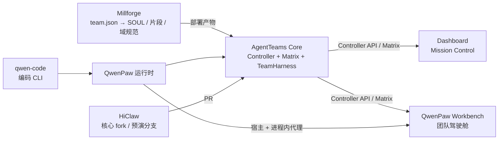

# 上游多仓追踪与能力对齐设计（Upstream Alignment）

Feature Name: upstream-alignment
Updated: 2026-10-25
Status: Draft for review
Scope: 追踪 AgentTeams 生态多仓动态，定义 Dashboard 的契约对齐、能力边界、路线图与验收方式。

## 0. 摘要

AgentTeams 生态正在从「Matrix 文本协作」升级为「机器可观察、可审计、可控制」的协议面，同时出现了两个客户端壳：官方 Dashboard 与 QwenPaw 插件式工作台。本设计解决三个问题：

1. **追踪**：哪些上游仓库/分支/PR 会改变 Dashboard 的数据契约。
2. **对齐**：哪些能力应当由 Dashboard 消费，哪些交由插件工作台，避免重复建设。
3. **排期**：用可验证的里程碑与降级策略，把上游契约逐步变成 Dashboard 功能。

本设计**不包含代码实现**，也不把未合并的上游 PR 当成稳定契约。

## 1. 背景与目标

### 1.1 背景

- 上游核心在 2026-10 集中落地 signal 事件、投影新鲜度、coding-run 读契约、S3 存储、运行时升级等能力。
- 主要贡献者 LUOSENGWA 的工作重心已从 Dashboard 转向上游核心仓，并维护一个独立的 QwenPaw 插件工作台与协议编译器 Millforge。
- Dashboard 目前只消费了 coding-run v2 契约；signal 事件、attention、loop 预算、投影新鲜度、human 文件区、runtime adapter 均未消费。

### 1.2 目标

- G1 数据可信：界面能回答「这条数据有多新」。
- G2 人机回路闭环：attention 从产生、通知、查看到解决全程可追踪。
- G3 执行可观测：coding run 与 loop 预算可下钻、可审计。
- G4 运行时可演进：运行时、CLI、升级、存储迁移可控且有降级路径。

### 1.3 非目标

- 不在本期把插件工作台的功能逐页复制到 Dashboard。
- 不把 Millforge 作为正式上游契约依赖。
- 不为未合并 PR 提前承诺端到端能力。

## 2. 事实基线（2026-10-25）

| 对象 | 版本/状态 | 说明 |
| --- | --- | --- |
| agentscope-ai/AgentTeams | v1.2.5（2026-10-16）；v1.2.6 迭代中（17 open） | 最新提交 2026-10-24 |
| agentteams-dashboard | v1.3.1；Workbench 重构 #167 已合并 | 本仓 main |
| PR #168（本仓） | OPEN / CLEAN | Chat 协作面板重构 |
| LUOSENGWA/HiClaw | AgentTeams fork | 10-24/25 多个集成分支活跃 |
| agentteams-qwenpaw-workbench | v0.5.0-beta.16（2026-10-22） | 独立 QwenPaw 插件客户端，Apache-2.0 |
| Millforge（千锻） | v1.1.0（2026-10-22）；协议 v1.0 冻结 | 多 Agent 团队协议编译器 |
| LUOSENGWA/QwenPaw | agentscope-ai/QwenPaw fork | 6 个上游 PR 未合并 |
| LUOSENGWA/qwen-code | QwenLM/qwen-code fork | 文档 PR 已合入 |

数据来源：GitHub API（commits / PR / release / issue）与 Dashboard 代码探测。插件端能力数字来自其 README/CHANGELOG 自述，正式排期前需逐项核验。

## 3. 仓库关系与数据流



角色分工：

- **Millforge**：协议源与确定性编译，不实现运行时事件。
- **AgentTeams Core**：控制器、Matrix 通道、TeamHarness 状态机与事件发射。
- **QwenPaw + qwen-code**：Worker 运行时与编码 CLI 执行后端。
- **Dashboard**：官方 Mission Control，偏 L1、多团队、安装升级、模型/网关、审计与发布。
- **Workbench 插件**：嵌在 QwenPaw 的团队驾驶舱，偏 L2、房间内操作、审批与通知。

## 4. 关键判断

1. **Workbench 是第二客户端，不是小工具。** 它已覆盖工作流、聊天、通知、审批、技能、知识图谱、编码执行、运行时升级与运维自检；与 Dashboard 共享 Controller/Matrix 契约，但代码不共享。
2. **供给集中在少数贡献者，契约落地有排队。** 上游 31 个 open PR（含 signal-events 读接口、attention、loop 控制、human 文件区、runtime bundle、safe upgrade、存储迁移）决定了下一批功能能否开工。
3. **Millforge 与上游是同一条协议线的两端。** Millforge 定义 schema/不变式/合规证据，上游负责事件发射与状态机；Dashboard 的机会在「协议合规可视化」，而不是再造聊天壳。
4. **运行时契约仍在变化。** QwenPaw 的 coding-cli 管理 API、按会话审批等级、spawn 元数据等 PR 未合并；依赖它们的 UI 必须保留降级态。
5. **功能对等是陷阱。** 两个客户端的宿主、权限、分发方式不同；应按契约对齐、按用户旅程分工。

## 5. 双壳一契约

### 5.1 定位边界

| 维度 | Dashboard | Workbench 插件 |
| --- | --- | --- |
| 权限 | L1 / 多团队管理 | L2 / 团队内 |
| 宿主 | 浏览器（Next.js BFF） | QwenPaw 控制台 / PawApp |
| 强项 | 安装升级、Managers/Humans、模型与网关、审计、发布治理 | 房间内聊天、审批三面、通知中心、技能与知识库贴身操作 |
| 不该重复 | 团队内即时审批、宿主收件箱桥 | 多团队治理、安装器、模型网关管理 |

### 5.2 共享契约层

两端共享但不共享 UI：

1. Controller OpenAPI 类型与能力探测矩阵；
2. Matrix mention / 审批 payload / reply 链匹配规则；
3. 通知语义（基线抑制、离线补检、静音、点击定位）；
4. 运行时、Coding CLI、升级的状态机与错误码；
5. 设计 token 与移动端可达性标准。

实现方式二选一，需 ADR 决策：

- **方案 A（推荐先做）**：各自维护类型，但共享 golden fixtures 与契约测试，保证行为一致。
- **方案 B**：抽取 `@agentteams/contracts` 包，两端依赖；收益高但跨仓协作成本大。

## 6. 契约层设计

### 6.1 能力探测与版本矩阵

原则：**不做硬版本门，按数据渲染**。

- 端点 404 = 未部署：隐藏入口或显示占位卡，不报错。
- 5xx = 真实故障：显示可重试错误，与「未部署」区分。
- 每次发布更新支持矩阵：`Dashboard 1.4.x ↔ Core 1.2.6+`。
- 能力清单集中定义，禁止散落在组件里。

建议接口：

```ts
type UpstreamCapability = {
  id: string;
  detectPath: string;
  fallback: 'hide' | 'placeholder' | 'matrix-adapter';
  since?: string;
};
```

### 6.2 契约快照与黄金测试

- 对 Controller 响应做 JSON 快照，放在 `src/lib/__fixtures__/upstream/`。
- 每个代理路由至少一个契约测试：字段存在性、可选性、404/5xx 分支。
- 上游字段只做 additive 兼容；新字段必须有降级默认值。

### 6.3 Matrix mention 与审批

群房间中未被 mention 的消息不会进入 Worker 消费队列。审批命令必须同时携带：

1. `m.mentions.user_ids`；
2. `formatted_body` 中的 `matrix.to` 链接；
3. 正文纯文本 `@worker`。

决议关联：

- 使用 reply 链匹配审批 event_id，避免同房间多条 pending 误消。
- 房间侧已决议时标记「已发送」，阻止宿主超时后的陈旧 deny 补发。
- 持久化 `resolvedVia`（`tool | dashboard | im_reply | im_command | api`）、`resolvedBy`、`resolvedAt`。

### 6.4 通知语义

Dashboard 需要把现有 HITL inbox 与邀请通知升级为统一通知中心：

- 首次同步建立基线，历史消息不通知；
- 离线期间的事件在首轮 sync 补检；
- 静音房间不推送；
- 未读角标、点击直达消息/审批/项目；
- 通知来源与数据正源显式标注（Matrix / Controller / signal events）。

### 6.5 投影新鲜度与一致性

上游 #1407 已合并，Controller workflow 响应新增：

- `projection_age_ms`：本次读取实际使用对象的最大 mtime 距今；
- `is_stale`：超过 `PROJECTION_STALE_MS`（默认 30s）；
- `?consistency=strong`：双读，返回 `X-Consistency: strong`。

Dashboard 策略：

- 所有 workflow 读取在 UI 上展示新鲜度（正常/滞后/未知）。
- 用户手动刷新、写操作回读、关键审批前使用 `consistency=strong`。
- 写路径响应返回 `0/false`，不参与新鲜度判断。
- 代理已透传 query，无需新增后端参数；类型与 UI 需要补齐。

SLO：`projection_age_ms` p95 < 30s；`is_stale` 比例 < 1%。

### 6.6 Signal 事件与 attention

上游 #1405 已合并事件发射与 `list_events`；#1433 提供 HTTP 读接口：

```
GET /api/v1/projects/{id}/signal-events
  ?type=SIG-DECISION,SIG-VERDICT
  &task=<taskId>
  &since=<RFC3339>
  &limit=1..200
  &cursor=base64url("<occurred_at>\0<event_id>")
```

设计要点：

- 事件 ID 为确定性 `ev_<sha256[:16]>`，客户端按 ID 去重；
- 游标严格从锚点之后继续；
- 项目归属由 `ref` 或 task meta 解析，不修改事件 schema；
- Dashboard 侧新增 BFF 与 hook，内部统一为 `UpstreamEvent`；
- HITL 采用 adapter：Matrix 确认（现状）→ signal events（新增）→ attention todo（待上游 S1）。

### 6.7 运行时、CLI 与升级

上游已合并：#1360（容器 exec 管理 CLI）、#1365/#1381（coding-run 读契约）、#1364（QwenPaw 两阶段升级 + 回滚）。

仍待合并：#1430（分层安全升级编排）、#1411（QwenPaw × QwenCode bridge）、#1427（runtime adapter bundle）、#8156（QwenPaw coding-cli 管理 API）。

Dashboard 设计：

- 升级前展示预检四门（环境、存储、版本、运行中任务）；
- 升级过程展示阶段与回滚入口，禁止静默失败；
- Coding CLI 面板覆盖安装/升级/卸载/检查更新/settings；
- 未合并契约一律走能力探测与占位。

## 7. 能力对齐矩阵

| 能力 | Dashboard | Workbench | 上游契约 | 决策 |
| --- | --- | --- | --- | --- |
| 投影新鲜度 | 无 | 待核验 | #1407 已合并 | P0，Dashboard 先做 |
| signal 事件 | 无 | 待核验 | #1405 已合并；#1433 OPEN | P0，adapter + 降级 |
| attention todo | 部分（Matrix HITL） | 部分（审批三面） | #1418 OPEN；S1 未合 | P0/P1，先 adapter |
| 通知中心 | 部分（HITL/邀请） | 有 | 无统一契约 | P1，补语义 |
| 编码执行查看 | 有（v2） | 有 | 已合并 | 保持 |
| Coding CLI 全链 | 部分 | 有 | #1360 已合并；#8156 OPEN | P1，核验补齐 |
| 运行时升级 | 部分（CoPaw→QwenPaw） | 有 | #1364 已合并；#1430 OPEN | P1，补预检/回滚 |
| Loop 观测/控制 | 部分（iteration） | 部分（暂停/继续） | #1401 已合并；#1402/#1403/#1406 OPEN | P1/P2 |
| Human 文件区 | 无 | 待核验 | #1426 OPEN | P2 |
| 自检 / 运维 | 部分 | 有（L0–L3） | 无统一契约 | P2，吸收方法论 |
| 移动/触屏/暗色 | 部分 | 有 | 无 | P2，按审计清单补 |
| Millforge 合规视图 | 无 | 无 | Millforge 1.1.0 | P2/实验 |

## 8. 路线图与验收

### 8.1 Now（1–2 周）

| Epic | 交付 | 依赖 | 验收 |
| --- | --- | --- | --- |
| E1 多仓追踪 | 每周摘要 + 能力矩阵 + PR 清单 | GitHub API | 脚本可重复执行；覆盖 6 个仓 |
| E2 数据可信 | 新鲜度类型、UI chip、强一致刷新 | #1407 已合并 | 类型/组件测试；stale 可见 |
| E3 Signal adapter | BFF + hook + 去重 + 404 降级 | #1405；#1433 可探测 | 契约测试；无 404 报错 |
| E4 审批语义核验 | 三重 mention、reply 链、resolveVia | — | 单测 + 房间实测 |

### 8.2 Next（2–6 周）

| Epic | 交付 | 依赖 |
| --- | --- | --- |
| E5 通知中心 | 基线抑制、离线补检、静音、点击直达 | E3/E4 |
| E6 运行时升级 | 预检四门、阶段、回滚、批量 | #1364；#1430 |
| E7 Coding CLI 对齐 | 安装/升级/卸载/检查更新/settings | #8156 |
| E8 Loop 只读 | loop_id、预算、over_budget、控制审计 | #1401/#1406 |

### 8.3 Later（6–12 周）

| Epic | 交付 | 说明 |
| --- | --- | --- |
| E9 自检与集群版本 | L0–L3 自检、版本卡、运维入口 | 吸收 Workbench 方法 |
| E10 移动端审计 | 多宽度溢出、44px 触控、深色 | 形成 UI 审计矩阵 |
| E11 Millforge 合规 | 导入 team.json、合规/证据、事件映射 | 实验开关，只读 |
| E12 Human 文件区 | 个人文件、回收站、配额 | #1426 合并后 |

## 9. 指标体系

| 指标 | 目标 | 采集 |
| --- | --- | --- |
| 投影新鲜度 p95 | < 30s | workflow 响应字段 |
| stale 比例 | < 1% | UI/日志聚合 |
| 事件消费延迟 p95 | < 5s | signal events occurred_at |
| HITL 解决时长 | 中位数持续下降 | resolveVia 时间戳 |
| 能力降级率 | 可解释、可告警 | 404/5xx 分类 |
| 双端能力缺口 | 每季度收敛 | 能力矩阵 |

## 10. 工程方法与追踪机制

### 10.1 可复用实践

- **契约优先**：单一 JSON 源、确定性 ID、additive schema、404-not-403、cursor 分页。
- **黄金测试**：上游响应快照 + 双端行为断言。
- **证据登记**：每个功能记录数据正源、契约状态、降级路径、验收证据（参考 Workbench PRD 的 ✅/⚠️/🔗 标记）。
- **公共面恒等重构**：拆分前后导出集合 diff 为空（Workbench 用 228 导出 / 68 路由 / 1,616 键验证）。
- **UI 审计矩阵**：页签 × 宽度 × 主题；44px 触控目标；真溢出清零。
- **工程门**：noUnused、死代码、i18n key、敏感扫描、bundle 预算。
- **主干开发 + 特性开关**：小 PR、每日合并 main；上游 squash 合并后及时同步，避免长分支冲突。

### 10.2 每周追踪仪式

固定字段：

`repo | ref | date | type | contract impact | dashboard action`

覆盖范围：

1. `agentscope-ai/AgentTeams` 最近提交与 v1.2.6 milestone；
2. LUOSENGWA 在 core / QwenPaw 的 open PR；
3. `LUOSENGWA/HiClaw` 活跃分支；
4. `agentteams-qwenpaw-workbench` release 与 CHANGELOG；
5. `LUOSENGWA/Millforge` 版本与 known limitations；
6. `QwenLM/qwen-code` 仅看影响 coding bridge 的变更。

产出：本仓 tracking issue + 能力矩阵更新 + 本周需降级的契约清单。

## 11. 风险与降级

| 风险 | 影响 | 缓解 |
| --- | --- | --- |
| 上游 PR 长时间未合并 | 功能无法端到端 | 能力探测；adapter；不提前承诺 |
| Workbench 迭代更快 | 功能差距扩大 | 按契约对齐；只吸收方法论 |
| 双端权限语义漂移 | 审批/写入行为不一致 | 共享能力矩阵与 golden 测试 |
| 投影滞后被误当实时 | 决策基于旧数据 | 新鲜度 chip；强一致刷新；SLO |
| Millforge 事件面未接运行时 | 合规视图失真 | 只读对照；实验开关 |
| 长分支冲突 | 重复劳动 | 小 PR；每日同步 main |
| 契约字段漂移 | 运行时错误 | 快照测试与发布门禁 |

## 12. 待决问题

1. Dashboard 与 Workbench 的能力边界由谁维护？是否需要一份共同 owner 的矩阵？
2. 契约层选方案 A（共享 fixtures）还是方案 B（共享包）？
3. 事件通道用轮询还是 SSE/WebSocket？Workbench 自述已做到即时连接。
4. Millforge 合规视图是否进入正式路线，还是保持实验？
5. 是否采用 Workbench 的 L1/L2 路由级权限门语义？
6. 上游评审带宽是否可协调？是否需要把关键 PR 列入发布门禁？

## 附录 A：追踪命令

```bash
# 核心仓最近提交
gh api "repos/agentscope-ai/AgentTeams/commits?per_page=20" \
  --jq '.[] | [.sha[0:7], .commit.author.date, (.commit.message|split("\n")[0])] | @tsv'

# LUOSENGWA 全仓 open PR
gh search prs --author LUOSENGWA --state open --limit 50 \
  --json repository,number,title,createdAt

# HiClaw 活跃分支
gh api "repos/LUOSENGWA/HiClaw/branches?per_page=100" \
  --jq '.[] | [.name, .commit.sha[0:7]] | @tsv'

# 插件工作台 release
gh release list -R LUOSENGWA/agentteams-qwenpaw-workbench --limit 5

# Millforge 动态
gh api "repos/LUOSENGWA/Millforge/commits?per_page=10" \
  --jq '.[] | [.sha[0:7], .commit.author.date, (.commit.message|split("\n")[0])] | @tsv'

# QwenPaw 相关 PR
gh pr list -R agentscope-ai/QwenPaw --author LUOSENGWA --state open \
  --json number,title,createdAt
```

## 附录 B：版本与契约矩阵

| 组件 | 当前 | 下一版本 | 关键契约 |
| --- | --- | --- | --- |
| AgentTeams Core | v1.2.5 | v1.2.6（17 open） | signal events、projection freshness、coding runs |
| Dashboard | v1.3.1 | 1.4.x（建议） | 消费 core 1.2.6 的 additive 契约 |
| Workbench 插件 | 0.5.0-beta.16 | 0.5.0 | QwenPaw 2.0–2.2；core 1.2.5 |
| Millforge | v1.1.0 | v1.2 | protocol v1.0；signal/loop schema |
| QwenPaw | 2.x | 待 PR 合并 | coding-cli API、审批等级、spawn meta |
| qwen-code | 上游主线 | — | serve / permission 事件 |

## 变更记录

| 日期 | 变更 |
| --- | --- |
| 2026-10-25 | 初稿：多仓追踪、双壳定位、契约层、路线图 |
