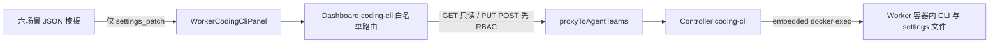
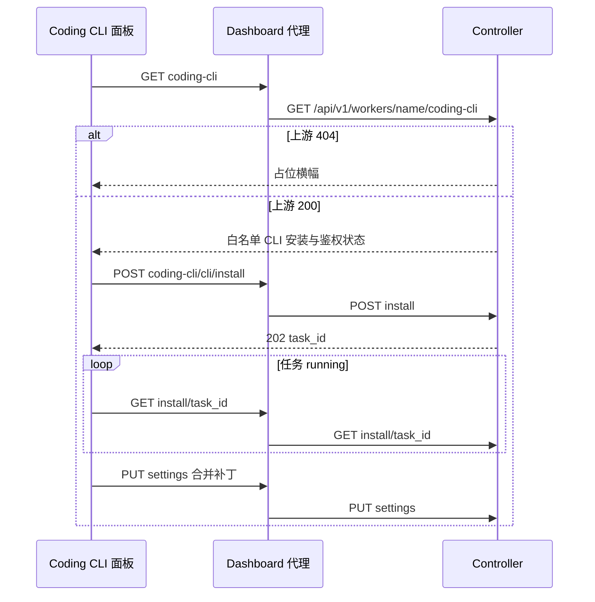

# Workbench 对齐（Coding CLI 管理面）

Feature Name: workbench-alignment
Updated: 2026-10-13

## Description

在 Dashboard Worker 详情中新增 Coding CLI 管理面板，经固定路径白名单代理消费 Controller `/api/v1/workers/{name}/coding-cli*`。Controller 端点未合入时走 404 占位；合入后同一面板点亮。六场景 preset 作为静态 JSON 随 Dashboard 打包，应用时只合并写入 `settings.model.name`。

本期消费面与 workbench 插件的 Worker 自管 `/api/coding-cli` 分离：Dashboard 只打 Controller。CLI 白名单为 `qwen-code`、`opencode` 与 `qoder`。

## Architecture





挂载点：`worker-detail-dialog.tsx`，位于 `WorkerToolsPanel` 之后、`WorkerChannelsPanel` 之前，编号 B7，独立 hunk。宿主以 `key={worker.name}` 重挂载，编辑态随卸载清零。

## Components and Interfaces

### 1. 白名单代理

**位置**：`src/app/api/agentteams/workers/[name]/coding-cli/[...rest]/route.ts`

沿用 channels `[...rest]` 模式：`isValidNameSegment` 校验每一段，`resolveEndpoint` 只放行下表，其余 400。写方法先 `enforceServerSideRbac(request, 'update', 'worker', name)`，再 `proxyToAgentTeams`。审计由 `proxyToAgentTeams` 对 PUT/POST 自动挂接（action 取路径末段 `settings` / `install`）。

| Dashboard 路径 | 方法 | Controller 路径 | 写 |
| --- | --- | --- | --- |
| `/api/agentteams/workers/{name}/coding-cli` | GET | `/api/v1/workers/{name}/coding-cli` | 否 |
| `/api/agentteams/workers/{name}/coding-cli/{cli}/settings` | GET | 同构 | 否 |
| `/api/agentteams/workers/{name}/coding-cli/{cli}/settings` | PUT | 同构 | 是 |
| `/api/agentteams/workers/{name}/coding-cli/{cli}/install` | POST | 同构 | 是 |
| `/api/agentteams/workers/{name}/coding-cli/{cli}/install/{task_id}` | GET | 同构 | 否 |

`{cli}` 仅 `{qwen-code, opencode, qoder}`。`qwen-code` 含连字符，已通过现有 `NAME_PATTERN`。`task_id` 走同一段名规则。`qoder` 于 #146 补齐，与既有 CLI 同级消费 Controller 同一管理面（上游 CLI registry 已含 `qoder`）。

### 2. Coding CLI 面板

**位置**：`src/components/dashboard/sections/workers/worker-coding-cli-panel.tsx`

**职责**：探测、安装/卸载、settings 编辑、preset 应用、状态横幅。

**状态机**（与 B5/B6 同构）：

| LoadState | 条件 | UI |
| --- | --- | --- |
| loading | 初值 / 首次探测未返回 | 加载指示 |
| unavailable | 探测 404 | 中性占位：「该 Worker 的编码 CLI 管理暂不可用」 |
| error | 400 / 502 / 503 / 网络失败 | 错误说明 + 重试 |
| ready | 探测 200 | CLI 列表与操作 |

写操作 403：面板切只读，提示「当前角色仅可查看」。authorizer 是权威，前端锁定只做 UX。

加载用 `setTimeout(0)` 调 `load`，避免 `react-hooks/set-state-in-effect`。

### 3. Settings 表单

对 GET settings JSON：

- 值为 `{ redacted: true, has_value: boolean }` 的键渲染为密钥输入：空白表示保留，提交时发哨兵 `***`；有输入则发新明文。
- `model.name`（或顶层 `model` 字符串）渲染为模型名输入。
- 其余可 JSON 序列化的键以只读预览 + 可选 JSON 补丁区展示，避免猜 CLI 私有字段。

`collectRedacted` 只递归普通对象；数组元素内的 `{redacted:true}` 不进入密钥输入，需经 JSON 补丁区写入。

PUT body 只含改动字段（深度合并在 Controller）。空对象不发。哨兵 400（无原值可保留）时提示填写真实密钥。

### 4. 安装任务

POST body：`{ "action": "install" | "uninstall", "version"?: string }`。接受 202 `{ task_id }` 后每 1.5s 查任务，直到 `done` / `failed` 或满 5 分钟。`done` 后重新探测。`409` 展示占用中。非法 version 的 400 展示校验失败。

### 5. Preset

**位置**：`src/lib/coding-cli-presets/`（从 workbench `frontend/src/presets/` 拷贝六份 JSON，构建期静态 import）。

| id | 自动写入 | 建议清单 |
| --- | --- | --- |
| p-harmony | `model.name = qwen3.6-27b-fp8` | 鸿蒙 CLT/JDK/Node env、MCP、HAP 目录 |
| p-web | 该模板 `settings_patch` | Web 工具链与 dist 目录 |
| p-android | 该模板 `settings_patch` | Android 工具链与 APK 目录 |
| p-ios | 该模板 `settings_patch` | iOS 代码级约定（构建在 macOS） |
| p-embedded | 该模板 `settings_patch` | MCU 工具链与 bin/elf 目录 |
| p-gencode | 空补丁（安装后默认态） | 无强制工具链 |

应用 preset = 对当前选中 CLI 发 PUT，body 仅为 `settings_patch`。成功后展开工具链 / MCP / 产物建议，每项标记「需人工确认」。Worker CR、env、MCP 绑定保持原状。后套模板覆盖 `model.name`，密钥等非 preset 字段由 Controller merge 保留。

### 6. 重建提示

探测项同时满足 `auth_configured === true` 且 `installed === false` 时，在该 CLI 行显示「容器重建后需重新安装；已保存的鉴权可保留」。重装成功后撤下。

## Data Models

```typescript
type CodingCliId = 'qwen-code' | 'opencode' | 'qoder';

interface CodingCliProbeItem {
  id: CodingCliId;
  installed: boolean;
  version?: string;
  auth_configured?: boolean;
}

interface CodingCliProbeResponse {
  clis: CodingCliProbeItem[];
}

type Redacted = { redacted: true; has_value: boolean };

type SettingsValue = string | number | boolean | null | Redacted | SettingsObject | SettingsValue[];
interface SettingsObject { [key: string]: SettingsValue }

interface InstallRequest {
  action: 'install' | 'uninstall';
  version?: string;
}

interface InstallAccepted {
  task_id: string;
}

interface InstallTask {
  task_id: string;
  status: 'running' | 'done' | 'failed';
  exit_code?: number;
  stderr?: string;
}

interface CodingCliPreset {
  id: string;
  name: { 'zh-CN': string; 'en-US'?: string };
  description?: { 'zh-CN': string; 'en-US'?: string };
  team_mapping?: {
    team: string;
    workers: string[];
    note?: { 'zh-CN': string; 'en-US'?: string };
  };
  settings_patch: SettingsObject;
  toolchain: {
    shared_volume?: string | null;
    install?: { 'zh-CN': string; 'en-US'?: string };
    env?: Record<string, string>;
    human_confirm: boolean;
    note?: { 'zh-CN': string; 'en-US'?: string } | string | null;
  };
  mcp: {
    suggested: string[];
    human_confirm: boolean;
    note?: string | null;
  };
  artifacts?: { minio_path?: string; note?: string };
  arch_note?: { 'zh-CN': string; 'en-US'?: string };
  discipline?: { 'zh-CN': string; 'en-US'?: string };
}
```

探测响应若缺 `clis` 数组，面板按空列表渲染白名单各行（均未安装），避免上游字段漂移导致空白。

## Correctness Properties

- Dashboard 只转发上表白名单路径与 CLI id；其它 rest 组合返回 400，请求达不到 Controller。
- 密钥输入空白且 `has_value` 为 true 时，PUT 对应键值为 `***`；浏览器响应中的密钥字段保持脱敏形态。
- preset PUT body 的键集合等于该模板 `settings_patch` 的键集合。
- 同一 Worker 同一时刻面板只展示一个「已应用 preset」标记；再应用另一个则替换标记。
- `key={worker.name}` 保证换 Worker 后安装轮询、settings 草稿、preset 标记全部丢弃。
- 占位文案使用中性产品用语。
- kube / 非 embedded 的 503、容器不可达的 502 原样透传 status，由面板映射中文说明。
- qwenpaw / openclaw / coworker / deepseek-harness 共用同一面板，无运行时分支。
- `team_mapping` / `discipline` 与双语字段为随模板导入的参考数据，Dashboard 不读取；`team_mapping.workers` 是展示标签列表（与真实 Worker id 混排），任何代码都不得把它当作 Worker 名使用。

## Error Handling

| 状态 | 来源 | 面板行为 |
| --- | --- | --- |
| 404 | 端点未合入或 L2 跨团队隐藏 | unavailable 占位 |
| 400 路径 | Dashboard 白名单 | 不发上游；测试断言 |
| 400 业务 | 非法 version / 哨兵无原值 | 表单旁错误说明 |
| 403 | Dashboard RBAC 或 Controller Leader 只读 | 只读 + 权限说明 |
| 409 | 同 CLI 安装占用 | 占用中说明，保留已有 task 轮询 |
| 502 | 容器内命令不可达 | 错误横幅 + 重试 |
| 503 | 非 embedded / kube | 「当前部署模式不支持容器内安装与配置」 |
| 202 后超时 | 5 分钟仍 running | 停止轮询，提示继续稍后刷新 |

## Test Strategy

路由测试 `coding-cli/[...rest]/route.test.ts`（对齐 channels）：

1. GET `[]` 转发探测，`forwardBody: false`。
2. GET/PUT `{cli}/settings` 仅 `qwen-code`、`opencode`、`qoder`。
3. POST `{cli}/install` 调 RBAC 且 `forwardBody: true`。
4. GET `{cli}/install/{task_id}` 转发。
5. 白名单外 CLI id、多余段、非法 Worker 名 → 400，不调 proxy。
6. PUT/POST 在 RBAC 拒绝时短路，不调 proxy。

面板测试 `worker-coding-cli-panel.test.tsx`（对齐 runtime-config / tools）：

1. 探测 404 → 占位文案，文案不含 PR 数字。
2. 探测 200 → 渲染两行 CLI 状态。
3. 密钥留空且 `has_value` → PUT body 含 `***`。
4. 安装 202 → 轮询到 `done` 后再次探测。
5. 安装 `failed` → 展示 stderr 或退出码。
6. 503 → kube/embedded 文案。
7. 应用 p-harmony → PUT body 仅为 `{ model: { name: "qwen3.6-27b-fp8" } }`，并出现需确认清单。
8. `auth_configured` 且未安装 → 重装提示。

验证顺序：`./node_modules/.bin/tsc --noEmit` → eslint 仅改动文件 → `./node_modules/.bin/vitest run` 目标文件。

## Implementation Order

1. 拷贝六份 preset JSON + TypeScript 类型。
2. 白名单路由与路由测试。
3. 面板与面板测试。
4. 挂到 `worker-detail-dialog.tsx`。
5. 三门验证。

## References

[^1]: (Website) - [Controller coding-cli PR 1360](https://github.com/agentscope-ai/AgentTeams/pull/1360)
[^2]: (Website) - [workbench 仓库](https://github.com/LUOSENGWA/agentteams-qwenpaw-workbench)
[^3]: (Website) - [workbench preset README](https://raw.githubusercontent.com/LUOSENGWA/agentteams-qwenpaw-workbench/main/frontend/src/presets/README.md)
[^4]: (Filename) - [channels 白名单代理](src/app/api/agentteams/workers/[name]/channels/[...rest]/route.ts)
[^5]: (Filename) - [runtime-config 透传](src/app/api/agentteams/workers/[name]/runtime-config/route.ts)
[^6]: (Filename) - [tools 404 占位面板](src/components/dashboard/sections/workers/worker-tools-panel.tsx)
[^7]: (Filename) - [Worker 详情挂载点](src/components/dashboard/sections/workers/worker-detail-dialog.tsx)
[^8]: (Filename) - [proxy 审计挂接](src/app/api/agentteams/proxy-helper.ts)
[^9]: (Filename) - [本期需求](.monkeycode/specs/workbench-alignment/requirements.md)
